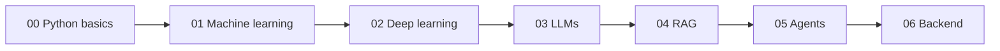

# FromPython2Agent: Learn AI Agents from Python Basics, Step by Step

**FromPython2Agent is an open learning roadmap and exercise collection that goes from Python fundamentals to machine learning, deep learning, LLMs, retrieval-augmented generation (RAG), AI agents, and backend services.** Each stage holds hands-on Jupyter notebooks and small projects. Exercises keep their function signatures, formulas, API references and self-check cells, and leave the implementation as `TODO` for you to write.

从 Python 基础一路学到 AI Agent 的个人学习路线：机器学习、深度学习（NumPy 手写 + PyTorch）、LLM、RAG、Agent 与 FastAPI 后端，每一步都有可运行的练习和自检。

[](https://www.python.org/)
[](https://pytorch.org/)
[](https://jupyter.org/)
[](https://docs.astral.sh/uv/)
[](https://fastapi.tiangolo.com/)
[](#supported-languages)

*Last updated: 2026-11-15*

## Contents

- [Who is this repository for?](#who-is-this-repository-for)
- [Roadmap](#roadmap)
- [What does each stage contain?](#what-does-each-stage-contain)
- [How do the exercises work?](#how-do-the-exercises-work)
- [Quick start](#quick-start)
- [Technical stack](#technical-stack)
- [Supported languages](#supported-languages)
- [Repository layout](#repository-layout)
- [FAQ](#faq)
- [Related learning resources](#related-learning-resources)
- [Contributing and conventions](#contributing-and-conventions)

## Who is this repository for?

This repository is for self-learners who know some Python and want to understand how AI agents work underneath, by building each layer themselves. You implement the math first (gradient descent, backpropagation, convolution, BPTT), then rebuild the same ideas with [PyTorch](https://pytorch.org/), and finally connect models to retrieval, tools and APIs.

It is a working learning log, not a finished course. Every stage lists its real status below, including drafts and unfinished parts.

## Roadmap

The two-digit folder prefixes define the learning order: `00 → 01 → 02 → 03 → 04 → 05 → 06`. Status legend: ✅ done · 🧪 exercise ready (TODOs for the learner) · 🚧 in progress or draft · 🗓️ planned.



| Stage | Topic | What you build | Status |
| --- | --- | --- | --- |
| 00 | [Python basics](00_python_basics/README.md) | 14 ordered notes: variables, strings, collections, functions, classes, typing | ✅ notes · 🚧 exercises |
| 01 | [Machine learning](01_machine_learning/README.md) | Linear regression, gradient descent, feature scaling, logistic regression, regularization; VGG from scratch | ✅ labs · 🧪 logistic-regression TODO branch |
| 02 | [Deep learning](02_deep_learning/README.md) | Two-layer NN in NumPy; CNN on MNIST; hand-written RNN and LSTM | 🧪 exercises (TODOs for the learner) |
| 03 | [LLMs](03_llm/README.md) | Minimal chat clients; transformer study notebook | 🚧 draft |
| 04 | [RAG](04_rag/README.md) | Retrieval and generation with local [Ollama](https://ollama.com/) models | 🚧 demo |
| 05 | [Agents](05_agents/README.md) | Tool-calling agent loop | 🚧 draft |
| 06 | [Backend](06_backend/README.md) | Four-week [FastAPI](https://fastapi.tiangolo.com/) lab: API contracts, dependency injection, testing, uploads, Docker, auth | 🧪 study guides + TODO apps |

### Next on the roadmap

- [ ] 02 Deep learning: automatic differentiation from scratch, GRU, optimizers (Momentum, Adam), BatchNorm and Dropout ablations
- [ ] 03 LLMs: finish the transformer implementation (attention, positional encoding, training loop)
- [ ] 04 RAG: embeddings and vector index evaluation beyond the toy dataset
- [ ] 05 Agents: a working ReAct-style loop with real tools and an evaluation harness
- [ ] 06 Backend: serve a trained model from stage 02 behind the FastAPI service

## What does each stage contain?

### 00 · Python basics

Fourteen short Markdown notes, from [comments](00_python_basics/01_comments.md) to [collections](00_python_basics/14_collections.md), plus a [strings exercise](00_python_basics/exercises/01_strings.py).

### 01 · Machine learning

Labs that follow course 1 (Supervised Machine Learning), weeks 1–3, of the [Machine Learning Specialization](https://www.coursera.org/specializations/machine-learning-introduction):

| Week | Topics | Folder |
| --- | --- | --- |
| C1 W1 | Cost function, gradient descent | [C1_W1](01_machine_learning/01_supervised_learning/C1_W1/README.md) |
| C1 W2 | Multiple linear regression, feature scaling, learning rate, polynomial features, scikit-learn | [C1_W2](01_machine_learning/01_supervised_learning/C1_W2/) |
| C1 W3 | Classification, sigmoid, decision boundary, logistic loss, overfitting, regularization | [C1_W3](01_machine_learning/01_supervised_learning/C1_W3/) |

Also: [VGG from scratch](01_machine_learning/VGG/README.md) in PyTorch, and a logistic-regression exercise with API references on the [`exercise/logistic-regression-todo`](https://github.com/KaneYin/FromPython2Agent/tree/exercise/logistic-regression-todo) branch (not merged yet).

### 02 · Deep learning

Each lab is a Jupyter notebook (Chinese; the two-layer network also has an English version) with formulas, API tables, a NumPy / PyTorch / TensorFlow comparison, self-check cells and finished plotting code.

| Lab | What you implement | Functions to write |
| --- | --- | --- |
| [01 · Two-layer neural network (NumPy)](02_deep_learning/01_two_layer_nn_numpy/README.md) | Forward pass, binary cross-entropy, backpropagation, gradient checking on Two Moons | 14 |
| [02 · CNN on MNIST](02_deep_learning/02_cnn_mnist_pytorch/README.md) | NumPy `conv2d` and max pooling, then a PyTorch CNN with a full train / validate / test pipeline (≈98% test accuracy) | 17 |
| [03 · RNN memory task](02_deep_learning/03_rnn_memory_pytorch/README.md) | Hand-written RNN, BPTT, gradient clipping; sequence lengths 10 / 30 / 100 | 7 |
| [04 · LSTM memory task](02_deep_learning/04_lstm_memory_pytorch/README.md) | Hand-written LSTM checked against `nn.LSTMCell`; forget-gate bias and gate visualization | 5 |

### 03 · LLMs

- [Minimal chat](03_llm/01_minimal_chat/README.md): a direct-provider example and a draft abstraction layer using [LangChain](https://python.langchain.com/) and [LiteLLM](https://docs.litellm.ai/).
- [Transformer study](03_llm/02_transformer_from_scratch/README.md): tokenization and generation exploration with [TransformerLens](https://github.com/TransformerLensOrg/TransformerLens); the implementation section is unfinished.

### 04 · RAG

[Basic RAG](04_rag/01_basic_rag/README.md): embed a small text corpus, retrieve the closest chunks, and answer with a local Ollama model.

### 05 · Agents

[Agent loop](05_agents/01_agent_loop/README.md): a tool-calling loop draft on the [OpenAI Python SDK](https://github.com/openai/openai-python). It currently has a known syntax error and canned tool results.

### 06 · Backend

[FastAPI lab](06_backend/01_fastapi/README.md): a four-week path covering API contracts, dependency injection, testing with [pytest](https://docs.pytest.org/), MNIST image uploads, Docker and blog authorization, paired with an [ML workshop](90_resources/courses/fastapi/README.md).

### 90 · Resources

[Course archives and self-study material](90_resources/README.md): CMU [11-768 AI Agents](90_resources/courses/cmu/11_768_ai_agents/README.md), [11-763 LLM Inference](90_resources/courses/cmu/11_763_llm_inference/), [11-868 LLM Systems](90_resources/courses/cmu/11_868_llm_systems/README.md), and an [agent self-study pack](90_resources/agent_selfstudy/README.md) with papers, blog notes and annotated reference implementations. The [resource index](INDEX.md) maps concepts (ReAct, tool use, memory, RAG) to slides, papers and code.

## How do the exercises work?

Exercise notebooks keep each function's signature, docstring and `TODO` hints, and raise `NotImplementedError` until you implement them. After every `TODO` there is a self-check cell that compares your result with a hand-computed value or with the PyTorch reference (for example `nn.Conv2d`, `nn.RNNCell`, `nn.LSTMCell`). Plotting code is already written, so you can see what your implementation does as soon as it passes.

The workflow:

1. Read the formula section at the top of the notebook.
2. Implement one `TODO` function.
3. Run the self-check cell right below it.
4. When everything passes, run **Restart Kernel → Run All**.

The English two-layer notebook is a blank exercise. The Chinese two-layer notebook includes the author's in-progress solutions; see its [README](02_deep_learning/01_two_layer_nn_numpy/README.md) for how to get the blank version.

## Quick start

There is no root install. Each project has its own environment managed by [uv](https://docs.astral.sh/uv/).

```bash
git clone https://github.com/KaneYin/FromPython2Agent.git
cd FromPython2Agent

# Example: the CNN lab
cd 02_deep_learning/02_cnn_mnist_pytorch
uv sync
# Open cnn_mnist_zh.ipynb in VS Code or Jupyter and select .venv/bin/python as the kernel
```

Every project README lists its own setup and run location. See the [repository guide](docs/REPOSITORY_GUIDE.md) for environment details.

## Technical stack

| Layer | Tools |
| --- | --- |
| Language and runtime | [Python](https://www.python.org/) 3.10–3.13 (most personal projects pin 3.13; the FastAPI lab pins 3.12) |
| Environments | [uv](https://docs.astral.sh/uv/) with one `pyproject.toml` and `uv.lock` per project |
| Notebooks | [Jupyter](https://jupyter.org/) / ipykernel, [Matplotlib](https://matplotlib.org/) |
| Numerical and classical ML | [NumPy](https://numpy.org/), [scikit-learn](https://scikit-learn.org/), [pandas](https://pandas.pydata.org/) |
| Deep learning | [PyTorch](https://pytorch.org/), [torchvision](https://pytorch.org/vision/), [TensorFlow / Keras](https://www.tensorflow.org/) (FastAPI ML workshop) |
| LLM tooling | [TransformerLens](https://github.com/TransformerLensOrg/TransformerLens), [LangChain](https://python.langchain.com/), [LiteLLM](https://docs.litellm.ai/), [OpenAI SDK](https://github.com/openai/openai-python), [Ollama](https://ollama.com/) |
| Backend | [FastAPI](https://fastapi.tiangolo.com/), [HTTPX](https://www.python-httpx.org/), [pytest](https://docs.pytest.org/), [Docker](https://www.docker.com/) |
| Reference projects (90_resources) | [Modal](https://modal.com/), [Transformers](https://huggingface.co/docs/transformers), TypeScript / Node.js with the [Vercel AI SDK](https://sdk.vercel.ai/) |

## Supported languages

| Kind | Languages |
| --- | --- |
| Documentation | English (root README, stage READMEs, FastAPI guides) · 简体中文 (deep-learning labs, two-layer NN notebook, resource index) |
| Bilingual notebooks | Two-layer NN: [中文](02_deep_learning/01_two_layer_nn_numpy/two_moons_two_layer_nn_zh.ipynb) and [English](02_deep_learning/01_two_layer_nn_numpy/two_moons_two_layer_nn_en.ipynb), aligned cell by cell |
| Programming languages | Python (all personal projects and notebooks); TypeScript and Shell in imported reference projects under `90_resources/` |

## Repository layout

```text
FromPython2Agent/
├── 00_python_basics/        # 14 notes + exercises
├── 01_machine_learning/     # supervised-learning labs (C1 W1–W3), VGG
├── 02_deep_learning/        # NumPy / PyTorch labs (two-layer NN, CNN, RNN, LSTM)
├── 03_llm/                  # minimal chat, transformer study
├── 04_rag/                  # basic Ollama RAG
├── 05_agents/               # tool-calling agent loop
├── 06_backend/              # four-week FastAPI lab
├── 90_resources/            # course archives, papers, notes, reference code
├── docs/                    # repository guide, code review log
├── INDEX.md                 # concept → slides / papers / code index
└── README.md
```

| Branch | Contents |
| --- | --- |
| [`main`](https://github.com/KaneYin/FromPython2Agent/tree/main) | Learning path, including the deep-learning labs |
| [`exercise/logistic-regression-todo`](https://github.com/KaneYin/FromPython2Agent/tree/exercise/logistic-regression-todo) | Logistic regression TODO exercise |

## FAQ

### Do I need a GPU?

No. The NumPy labs, the RNN and LSTM labs and the ML labs run on a laptop CPU. The CNN lab uses CUDA or Apple MPS when available; on Apple MPS one MNIST epoch takes about 6 seconds, and CPU-only training is slower but practical for the 5-epoch target.

### Why implement things in NumPy before using PyTorch?

Writing convolution, backpropagation and BPTT by hand shows what each tensor shape and gradient means. The PyTorch version then becomes a check: each lab compares your hand-written layer with the built-in one (`nn.Conv2d`, `nn.RNNCell`, `nn.LSTMCell`) on the same weights.

### Are solutions included?

Mostly no. The labs contain stubs, self-checks and plots; the self-checks tell you whether your implementation is correct. The one exception is the Chinese two-layer notebook, which holds the author's in-progress answers.

### Why is the logistic-regression exercise on a separate branch?

It is a TODO rewrite of an existing notebook, kept on [`exercise/logistic-regression-todo`](https://github.com/KaneYin/FromPython2Agent/tree/exercise/logistic-regression-todo) until it is reviewed and merged.

### What is the difference between this repository and a course?

A course gives you a finished curriculum. This repository records one learner's path, with exercises designed around official documentation and university course material (CMU 11-768, 11-763, 11-868) collected in [`90_resources`](90_resources/README.md).

## Related learning resources

Projects whose structure inspired this roadmap, and that are worth studying alongside it:

- [karpathy/nn-zero-to-hero](https://github.com/karpathy/nn-zero-to-hero): neural networks built from scratch in code
- [microsoft/ML-For-Beginners](https://github.com/microsoft/ML-For-Beginners): a 12-week classical machine-learning curriculum
- [d2l-ai/d2l-zh](https://github.com/d2l-ai/d2l-zh) / [Dive into Deep Learning](https://d2l.ai/): deep learning with math, code and discussion
- [mlabonne/llm-course](https://github.com/mlabonne/llm-course): an LLM roadmap from fundamentals to deployment
- [CMU 11-768 AI Agents](https://cmu-agents.com): the agents course archived in this repository

## Contributing and conventions

Issues and suggestions are welcome. New material follows these rules:

- Use a two-digit prefix and `snake_case`, for example `03_gru_memory_pytorch/` inside `02_deep_learning/`.
- Give every project its own README, `pyproject.toml` and `uv.lock`, then list it in its stage README.
- Add concept and resource links to [INDEX.md](INDEX.md).

The full naming rules and the path migration map are in the [repository guide](docs/REPOSITORY_GUIDE.md); historical findings are in the [code review log](docs/CODE_REVIEW.md).

Local credentials, virtual environments, caches, PDFs and some datasets or weights are ignored by Git, so a fresh clone does not contain them.
